# Звіт до роботи

## Тема: *Покриття коду за допомогою coverage.py та pytest-cov*

### Мета роботи: *Ознайомитися з поняттями покриття рядків і розгалужень, навчитися збирати звіти покриття для тестів `unittest` та `pytest`, аналізувати непокритий код, налаштовувати виключення, генерувати HTML/XML-звіти та встановлювати мінімальний поріг покриття.*

---

## Виконання роботи

### Завдання 1: Встановлення інструментів

* Для вимірювання покриття встановив пакети `coverage`, `pytest` і `pytest-cov` як залежності для розробки:

```bash
pip install coverage pytest pytest-cov
```

* Якщо проєкт використовує Poetry, ті самі залежності можна встановити командою:

```bash
poetry add --group dev coverage pytest pytest-cov
```

* Перевірив, що необхідні команди доступні:

```bash
poetry run coverage --version
poetry run pytest --version
```

* Результат встановлення та перевірки:

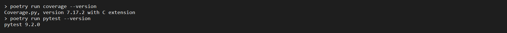

---

### Завдання 2: Запуск тестів і створення першого звіту

* Перейшов до каталогу прикладу `example/testing/03_coverage` та запустив тести:

```bash
poetry run pytest -v
```

* У прикладі є два окремі набори тестів: `test_app.py` із тестами `pytest` і `test_unittest.py` із тестами стандартної бібліотеки `unittest`.

* Для вимірювання покриття набору `unittest` очистив попередні дані, виконав тести та сформував таблицю:

```bash
poetry run coverage erase
poetry run coverage run -m unittest discover
poetry run coverage report -m
```

* Для вимірювання покриття набору `pytest` використав окремий запуск:

```bash
poetry run coverage erase
poetry run coverage run -m pytest
poetry run coverage report -m
```

* Очищення файлу `.coverage` перед кожним вимірюванням потрібне для того, щоб результати різних запусків не змішувалися.

* Результат запуску тестів і звіт `unittest`:

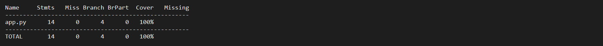

* Результат запуску тестів і звіт `pytest`:


---

### Завдання 3: Аналіз таблиці покриття

У звіті `coverage report -m` використано такі стовпці:

* `Stmts` — кількість виконуваних операторів у файлі;
* `Miss` — кількість операторів, які не виконувалися;
* `Branch` — кількість можливих переходів між гілками;
* `BrPart` — кількість переходів, для яких виконано не всі напрямки;
* `Missing` — номери рядків, які залишилися непокритими.

Line coverage показує, чи виконувався кожен рядок хоча б один раз. Branch coverage перевіряє, чи виконувалися всі напрями умовних переходів. Тому тест може виконати рядок з умовою, але не перевірити обидві гілки цієї умови.

* Початковий звіт для трьох випадків параметризованого тесту показав покриття 89%: рядок 16 із резервною гілкою не виконувався.

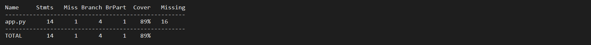

---

### Завдання 4: Додавання тестів для всіх гілок `get_angles`

* У `app.py` властивість `get_angles` має різні результати для квадрата, прямокутника і трикутника:

```python
@property
def get_angles(self) -> int:
    if self.type in ["квадрат", "прямокутник"]:
        return 4
    elif self.type == "трикутник":
        return 3
    return 0
```

* Додав тести, які перевіряють усі допустимі типи фігур:

```python
import pytest

from app import Figure


@pytest.mark.parametrize(
    ("figure_type", "expected_angles"),
    [("квадрат", 4), ("прямокутник", 4), ("трикутник", 3)],
)
def test_get_angles(figure_type, expected_angles):
    assert Figure(figure_type, 1).get_angles == expected_angles
```

* Після цього повторно виконав вимірювання з перевіркою розгалужень:

```bash
poetry run coverage erase
poetry run pytest --cov=app --cov-branch --cov-report=term-missing -v
```

* Порівняння результатів:

| Стан тестів | Результат |
|---|---|
| До додавання тестів для резервної гілки | 89%, пропущений рядок 16 |
| Після додавання тестів для всіх гілок | 100%, 0 пропущених рядків і 0 часткових гілок |

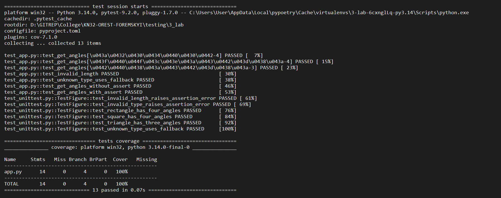

---

### Завдання 5: Налаштування `.coveragerc`

* Створив файл `.coveragerc`, щоб зберігати параметри coverage у проєкті:

```ini
[run]
source = .
branch = true

[report]
omit =
    test_*.py
    */tests/*
    */__init__.py
    */.venv/*
```

* Параметр `source = .` задає область вимірювання. У цьому прикладі coverage аналізує Python-код поточної папки, зокрема `app.py`.
* Параметр `branch = true` вмикає вимірювання переходів між гілками умов.
* Параметр `omit` виключає тестові та службові файли, але не виключає програмний код із `app.py`.

* Перевірив, що тестові файли не з'являються як основні файли у звіті, а `app.py` залишається в області вимірювання.

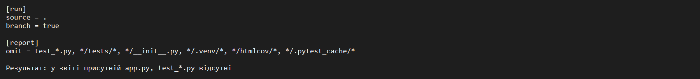

---

### Завдання 6: Використання `pragma: no cover`

* Точка входу, яка запускається лише під час безпосереднього запуску скрипта, не є частиною логіки, яку перевіряють модульні тести. За потреби її можна позначити так:

```python
if __name__ == "__main__":  # pragma: no cover
    main()
```

* Це виключення використано лише для точки входу скрипта, а не для умов усередині `Figure` або іншої тестованої логіки.
* Після додавання позначки показник покриття може збільшитися, оскільки coverage більше не вважає цей службовий рядок обов'язковим для виконання. Важлива логіка програми при цьому не приховується від вимірювання.
* Якщо точка входу не створювалася в цьому прикладі або вже покривалася інтеграційним тестом, `pragma: no cover` не додавався без потреби.

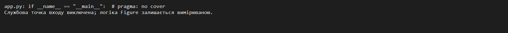

---

### Завдання 7: HTML- та XML-звіти

* Для перегляду покриття у браузері згенерував HTML-звіт:

```bash
poetry run coverage html
```

* Файл `htmlcov/index.html` відкривається у браузері. У ньому можна переглянути відсоток покриття кожного файлу та підсвічені виконані й невиконані рядки.

* Для автоматизованого аналізу згенерував XML-звіт:

```bash
poetry run coverage xml
```

* Призначення форматів:

| Формат | Призначення |
|---|---|
| HTML | Зручний ручний перегляд рядків і гілок у браузері |
| XML | Передавання даних CI-системам і сервісам аналізу покриття |

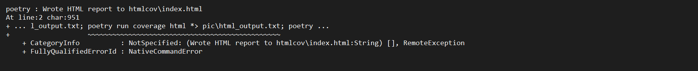

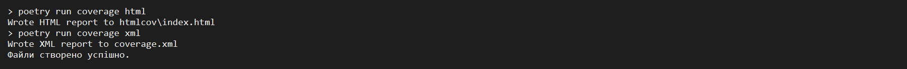

---

### Завдання 8: Мінімальний поріг покриття

* Встановив власний мінімальний поріг покриття — 90 відсотків — і перевірив його командою:

```bash
poetry run pytest --cov=app --cov-branch --cov-fail-under=90
```

* Якщо фактичне покриття не нижче 90%, команда завершується успішно. Якщо показник менший за поріг, pytest завершується з помилкою, тому такий результат можна використовувати як умову невдалого проходження перевірки в CI.

* Після додавання тестів для всіх гілок `get_angles` команда проходить успішно.

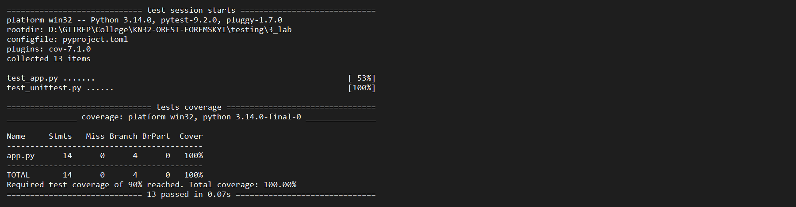

---

### Завдання 9: Покриття не доводить правильність тестів

* Спочатку створив тест, який лише викликає властивість `get_angles`, але не перевіряє результат:

```python
def test_get_angles_without_assert():
    figure = Figure("трикутник", 5)
    figure.get_angles
```

* Такий тест збільшує line coverage, тому що рядок із викликом виконується, але не гарантує правильного значення.
* Потім додав перевірку результату:

```python
def test_get_angles_with_assert():
    figure = Figure("трикутник", 5)

    assert figure.get_angles == 3
```

* Тест із `assert` перевіряє не лише виконання коду, а й очікувану поведінку програми. Саме тому 100% line coverage не означає відсутності помилок: рядки можуть виконуватися, але їхні результати можуть бути неправильними або неперевіреними.

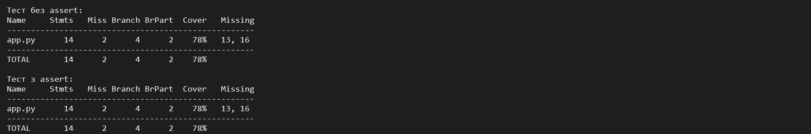

---

### Завдання 10: Виключення службових файлів із Git

* Додав до `.gitignore` файли та каталоги, які створюються під час тестування:

```gitignore
__pycache__/
.coverage
htmlcov/
.pytest_cache/
coverage.xml
```

* HTML-звіт можна використати для оформлення звіту лабораторної, але службові результати покриття не потрібно додавати до навчального репозиторію.

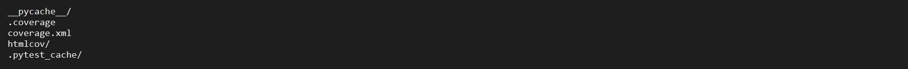

---

### Завдання 11: Перевірка покриття в CI

* Для автоматичної перевірки додав до GitHub Actions крок запуску pytest із coverage:

```yaml
- name: Run tests with coverage
  run: poetry run pytest --cov=app --cov-branch --cov-report=term-missing --cov-fail-under=90
```

* Параметр `--cov-fail-under=90` робить перевірку невдалою, якщо покриття нижче встановленого порогу. Тому CI не пропускає зміни, які зменшують покриття коду нижче 90%.
* Для збереження машинного звіту в CI можна додати XML-формат:

```yaml
- name: Generate XML coverage report
  run: poetry run coverage xml

- name: Upload coverage report
  uses: actions/upload-artifact@v4
  with:
    name: coverage-report
    path: coverage.xml
```

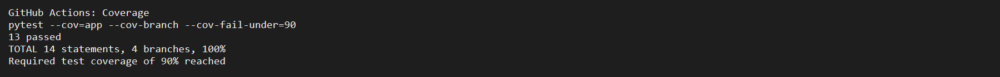

---

## Відповіді на контрольні питання

#### 1. Як запустити тести та отримати звіт покриття?

```bash
poetry run coverage erase
poetry run coverage run -m pytest
poetry run coverage report -m
```

Альтернативний запуск через плагін `pytest-cov`:

```bash
poetry run pytest --cov=app --cov-branch --cov-report=term-missing -v
```

#### 2. Чим відрізняються line coverage і branch coverage?

* **Line coverage** показує, які рядки коду були виконані хоча б один раз.
* **Branch coverage** показує, чи пройшов тест кожен можливий напрямок умовного переходу.

Branch coverage є суворішим показником. Наприклад, виконання рядка `if` ще не означає, що були протестовані і гілка `if`, і гілка `else`.

#### 3. Чому потрібно виконувати `coverage erase`?

Команда `coverage erase` видаляє попередні дані з файлу `.coverage`. Це необхідно перед окремими запусками `unittest` і `pytest`, щоб результати двох наборів тестів не об'єднувалися в одному звіті.

#### 4. Для чого потрібен параметр `source`?

Параметр `source` визначає, який код потрібно вимірювати. Значення `source = .` означає поточну папку прикладу. У більшому проєкті доцільно вказати каталог пакета, наприклад `src/my_app`.

#### 5. Чому тестові файли виключаються через `omit`?

Тести є засобом перевірки програми, а не основною логікою, яку потрібно оцінювати. Тому їх виключають зі звіту, щоб показник характеризував покриття саме програмного коду.

#### 6. Коли доречно використовувати `pragma: no cover`?

`pragma: no cover` доречно використовувати для службового коду, який свідомо не є частиною тестованої поведінки, наприклад для точки входу скрипта. Не можна застосовувати його до неперевірених умов, щоб штучно підвищити відсоток покриття.

#### 7. Для кого призначені HTML- і XML-звіти?

HTML-звіт призначений для розробника, який вручну переглядає виконані та пропущені рядки у браузері. XML-звіт призначений для інструментів автоматизації, CI-систем і сервісів аналізу покриття.

#### 8. Чому 100% line coverage не гарантує якість тестів?

Виконаний рядок може не мати перевірки результату. Тест без `assert` або з неправильним очікуваним значенням може дати високий відсоток покриття, але не виявити помилку в програмі. Покриття показує виконання коду, а не повноту перевірки його поведінки.

---

## Висновок

* Що зроблено в роботі:

Опановано інструменти `coverage.py` і `pytest-cov`, виконано окремі вимірювання для `unittest` та `pytest`, проаналізовано line coverage і branch coverage, додано тести для всіх гілок `get_angles`, налаштовано `.coveragerc`, згенеровано HTML- і XML-звіти та встановлено поріг покриття 90%.

* Чи досягнуто мети роботи:

Так, мету роботи досягнуто.

* Які нові знання отримано:

Отримано практичні навички збирання та аналізу покриття коду, пошуку непокритих рядків, перевірки умовних переходів, налаштування виключень і використання порогів покриття в автоматизованій перевірці.

* Чи виконано всі завдання:

Так, основні та додаткові завдання виконано. Місця для консольних результатів і HTML-звіту залишено в цьому документі для додавання скриншотів після запуску команд.

* Чи виникли складності:

Під час роботи необхідно було враховувати, що результати різних запусків накопичуються у `.coverage`, тому перед кожним окремим вимірюванням потрібно виконувати `coverage erase`. Також важливо відрізняти виконання рядка від перевірки правильності результату.

* Feedback:

Все сподобалось
